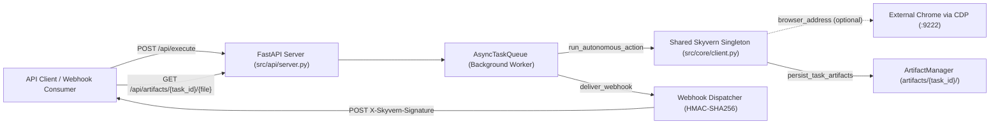

# Technical Architecture & API Specification

The Skyvern Automation Suite provides an asynchronous, hardened HTTP execution wrapper around the embedded Skyvern autonomous browser engine on macOS. It converts unstructured natural language browser commands and JSON Schema targets into deterministic structured data extraction, media capture, and event-driven notifications.

---

## 1. System Architecture

The service consists of a FastAPI interface, an asynchronous task queue with singleton execution semantics, an embedded Skyvern agent, a persistent artifact manager, an HMAC-secured webhook dispatcher, and Chrome DevTools Protocol (CDP) session attachment.



---

## 2. Component Design & Lifecycle Management

### FastAPI Lifespan & Concurrency Control
Embedded browser engines and SQLite metadata stores are prone to database lock contention and display server collisions under concurrent load. The suite implements an asynchronous task queue (`AsyncTaskQueue`) initialized within the FastAPI lifespan context:

1. **Queue Serialization:** Client requests submitted to `POST /api/execute` or `POST /api/introspect` receive an immediate HTTP response with a `task_id` and initial status `queued`.
2. **Worker Pool:** A dedicated background worker consumes tasks sequentially from an internal `asyncio.Queue`. This guarantees that only one Skyvern automation task executes on a given browser profile or local SQLite state at any time.
3. **Graceful Teardown:** On application shutdown, the worker drains pending tasks, flushes state, and cleanly releases browser contexts via `safe_aclose()`.

### External Chrome CDP Session Preservation
When executing against an attached Chrome instance via `cdp_url`:
* `Skyvern.run_task(...)` receives `browser_address="http://localhost:9222"`.
* The internal `start_fresh_browser` parameter is set to `False` on the underlying `TaskRunRequest` model.
* During client closure, `preserve_external_browser=True` prevents the server from sending `SIGTERM` or closing DevTools connections to the host Chrome process, preserving user cookies, tabs, and login state across tasks.

---

## 3. Configuration & Environment Variables

All settings load from environment variables or a root `.env` file via `src/core/config.py`:

| Variable | Type | Default | Description |
| :--- | :--- | :--- | :--- |
| `HOST` | string | `0.0.0.0` | Bind address for the FastAPI server. |
| `PORT` | integer | `8000` | Bind port for the FastAPI server. |
| `SKYVERN_API_KEY` | string | `""` | Optional internal API key guard for incoming endpoints. |
| `LLM_MODEL` | string | `openai/responses/gpt-6.1-terra` | Model identifier dispatched via LiteLLM. |
| `ARTIFACTS_DIR` | string | `artifacts` | Relative or absolute path for persistent artifact storage. |
| `ARTIFACT_RETENTION_DAYS` | integer | `7` | Retention threshold before artifact bundles are pruned. |
| `AUTO_PRUNE_ARTIFACTS` | boolean | `true` | Scans and cleans stale artifacts on server startup/shutdown. |
| `DEFAULT_CDP_URL` | string | `http://localhost:9222` | Default target when attaching to an existing browser. |
| `ENABLE_CDP` | boolean | `false` | When true, defaults all execution requests to `DEFAULT_CDP_URL`. |

---

## 4. API Specification

### Endpoints Overview

| Method | Endpoint | Description |
| :--- | :--- | :--- |
| `POST` | `/api/execute` | Enqueue an autonomous browser navigation and extraction task. |
| `POST` | `/api/introspect` | Enqueue a single-page introspection and schema extraction task. |
| `GET` | `/api/tasks/{task_id}` | Retrieve status, results, and artifact URLs for a specific task. |
| `GET` | `/api/artifacts/{task_id}/{file_name}` | Download or stream persisted screenshots, videos, and JSON files. |
| `GET` | `/api/cdp/status` | Probe the reachability and version of the local Chrome DevTools port. |
| `GET` | `/healthz` | Service health check. |

---

### `POST /api/execute`

Submits an autonomous workflow task.

#### Request Headers
* `Content-Type: application/json`

#### Request Body Schema
```json
{
  "url": "https://news.ycombinator.com",
  "prompt": "Extract the top 2 stories from the front page.",
  "extraction_schema": {
    "type": "array",
    "items": {
      "type": "object",
      "properties": {
        "title": {"type": "string"},
        "url": {"type": "string"}
      },
      "required": ["title", "url"]
    }
  },
  "max_steps": 30,
  "cdp_url": "http://localhost:9222",
  "webhook_url": "https://example.com/api/webhooks/skyvern",
  "webhook_secret": "secure_hmac_secret_key"
}
```

#### Response (`202 Accepted`)
```json
{
  "task_id": "00572c63-711d-4fdc-9c41-5e1761846e81",
  "task_type": "execute",
  "status": "queued",
  "result": null,
  "error": null,
  "webhook_url": "https://example.com/api/webhooks/skyvern",
  "webhook_delivered": null,
  "webhook_delivery_attempts": 0,
  "webhook_delivered_at": null,
  "cdp_url": "http://localhost:9222"
}
```

---

### `GET /api/tasks/{task_id}`

Retrieves the current execution state, extracted structured payload, artifact download paths, and webhook delivery telemetry.

#### Response (`200 OK`)
```json
{
  "task_id": "00572c63-711d-4fdc-9c41-5e1761846e81",
  "task_type": "execute",
  "status": "completed",
  "result": {
    "run_id": "tsk_597095714306986274",
    "status": "completed",
    "output": [
      {
        "title": "SpaceX catches the Starship to end Flight 15",
        "url": "https://www.spacex.com/launches/starship-flight-15"
      }
    ],
    "recording_url": "/api/artifacts/00572c63-711d-4fdc-9c41-5e1761846e81/recording.mp4",
    "screenshot_urls": [
      "/api/artifacts/00572c63-711d-4fdc-9c41-5e1761846e81/screenshots/action_0.png"
    ]
  },
  "error": null,
  "webhook_url": "https://example.com/api/webhooks/skyvern",
  "webhook_delivered": true,
  "webhook_delivery_attempts": 1,
  "webhook_delivered_at": "2026-11-15T14:52:30.000000+00:00",
  "cdp_url": "http://localhost:9222"
}
```

---

### `GET /api/artifacts/{task_id}/{file_name}`

Streams persisted run artifacts from `artifacts/{task_id}/`:
* `recording.mp4` (`video/mp4`)
* `extraction.json` (`application/json`)
* `task_metadata.json` (`application/json`)
* `screenshots/action_0.png` (`image/png`)

---

### `GET /api/cdp/status`

Probes `{cdp_url}/json/version` with a `2.0s` timeout and returns browser metadata.

#### Response (`200 OK`)
```json
{
  "available": true,
  "endpoint": "http://localhost:9222",
  "browser": "Chrome/157.0.8103.51",
  "protocol_version": "1.3"
}
```
